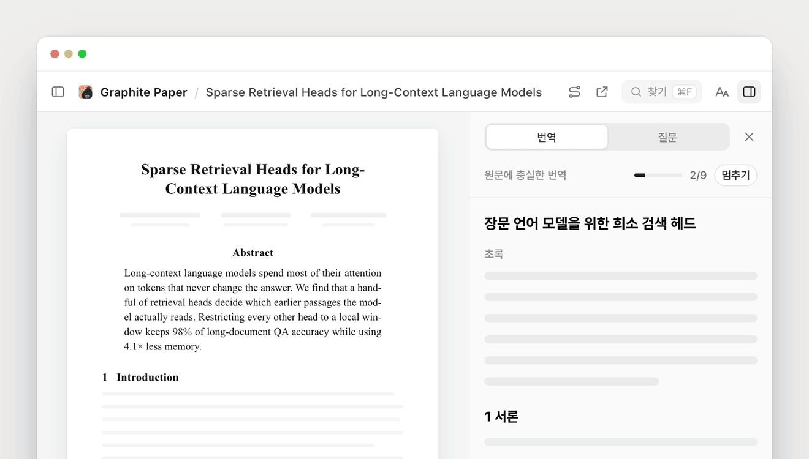

<p align="center">
  
</p>

<h1 align="center">Graphite Paper</h1>

<p align="center">
  원본 PDF를 보면서 문장 단위 번역, 그림·수식 설명, AI 질문을 한 화면에서 다루는 macOS 논문 리더
</p>

<p align="center">
  
</p>

[Graphite](https://github.com/aghoc/graphite)의 화면과 디자인을 바탕으로 논문 읽기 기능을 더한 macOS 앱입니다. PDF 원본 레이아웃을 그대로 보면서 오른쪽 사이드 뷰에서 문장 단위로 연결된 번역과 AI 질문을 함께 쓸 수 있습니다.

번역과 질문은 컴퓨터에 로그인해 둔 **Claude Code**, **Codex CLI**, **Gemini CLI**를 불러 처리하므로 기존 AI 구독이 있다면 API 키 없이 바로 시작할 수 있습니다. 필요하면 Anthropic, OpenAI, Google Gemini, DeepSeek, OpenRouter, Ollama 등 API도 연결할 수 있습니다.

## 주요 기능

### 원본 PDF와 문장 단위 번역
- **원본 그대로 읽기**: `pdf.js`로 2단 편집·수식·표·그림이 담긴 원본 PDF를 그대로 표시합니다. 확대·축소, 폭 맞춤, PDF 목차, 내부 인용 링크 이동과 이전 위치로 돌아가기를 지원합니다.
- **문장 단위 연결**: PDF 본문과 오른쪽 번역 탭이 문장마다 짝지어집니다. 한쪽 문장을 가리키거나 누르면 짝 문장이 함께 강조되고, PDF를 스크롤하면 번역도 현재 문장을 따라옵니다.
- **7개 언어 번역**: 한국어, 일본어, 중국어(간체), 스페인어, 프랑스어, 독일어, 포르투갈어를 지원합니다.

### 그림·표·수식 AI 설명
- **자동 감지 및 영역 선택**: PDF 안의 그림·표 위에 마우스를 올리면 설명 버튼과 이미지 복사가 뜨며(`E` 키로 바로 실행), 툴바의 영역 선택 도구로 원하는 그림·표·수식을 직접 드래그해 고를 수도 있습니다.
- **맞춤 풀이 & 이어서 질문**: 선택한 영역에 대해 그림 설명, 핵심 요약, 수식·기호 풀이, 직접 질문을 실행하고 플로팅 카드에서 대화를 이어갈 수 있습니다.

### 구절 선택 & 논문 질문·요약
- **말풍선 번역·질문**: PDF 본문에서 문장이나 단어를 선택하면 바로 번역, 쉬운 설명, 구절 질문을 실행할 수 있습니다.
- **질문 탭과 기록**: 논문 전체 요약, 현재 문단 쉬운 설명, 앞선 맥락을 기억하는 연속 대화를 지원하며 논문별 질문 기록을 저장합니다.

### 논문 탐색 · 읽기 로드맵 · 서재
- **간편한 열기**: PDF 파일(`⌘O`, 드래그 앤 드롭, Finder "다음으로 열기")이나 arXiv 번호·논문 링크·DOI(`⌘L`)로 논문을 엽니다. 마크다운 문서 보기와 편집도 함께 지원합니다.
- **AI 논문 찾기 & arXiv 검색**: 자연어로 읽고 싶은 주제를 물어 논문을 추천받거나 arXiv를 직접 검색해 바로 서재에 담습니다.
- **읽기 로드맵**: 지금 읽는 논문의 앞뒤로 함께 읽을 선행·후속 논문을 정리해 줍니다.
- **서재 관리**: 폴더를 만들어 드래그 앤 드롭으로 논문을 분류하고 읽음 상태를 관리합니다.

### 다양한 AI 모델과 자동 백업
- **로컬 CLI (구독 활용)**: Claude Code, Codex CLI, Gemini CLI
- **API & 로컬 서버**: Anthropic API, OpenAI, Google Gemini, DeepSeek, OpenRouter, OpenGateway, Ollama(로컬), 커스텀 OpenAI 호환 서버
- **자동 전환 백업**: 주 모델이 사용 한도에 걸리면 설정해 둔 백업 모델로 자동 전환합니다.
- **로컬 키 보관**: 입력한 API 키는 macOS 소유자 전용 파일(`keys.json`)에만 저장되며 웹뷰로 전달되지 않습니다.

## 단축키

| 단축키 | 동작 |
| --- | --- |
| `⌘O` | PDF 또는 마크다운 파일 열기 |
| `⌘L` | arXiv 번호·논문 링크·DOI로 열기 |
| `⌘J` | 오른쪽 사이드 뷰(번역·질문) 열기/닫기 |
| `⌘F` | 문서에서 찾기 |
| `⌘\` | 왼쪽 사이드바(서재·목차) 열기/닫기 |
| `⌘+` / `⌘−` / `⌘0` | PDF 확대·축소·폭 맞춤 (마크다운에서는 글자 크기) |
| `E` | 마우스를 올린 그림·표 바로 설명 |
| `⌘E` / `⌘S` | 마크다운 원문 편집 전환 / 저장 |

## 개발 및 설치

macOS에서 Node.js, Rust(1.85 이상), Xcode Command Line Tools가 필요합니다.

```bash
npm install
npm run dev
```

테스트는 `src-tauri`에서 실행합니다.

```bash
cd src-tauri
cargo test
```

앱 번들 빌드 및 `/Applications/Graphite Paper.app` 설치(교체):

```bash
npm run build   # .app 및 .dmg 빌드
npm run update  # 릴리스 .app 빌드 후 /Applications/Graphite Paper.app 교체
```

구현 상세와 구조는 [docs/PLAN.md](docs/PLAN.md)에서 확인할 수 있습니다.

## 라이선스

Graphite Paper 코드는 [MIT 라이선스](LICENSE)를 따릅니다. 논문 처리 코드의 일부는 [OpenPaper](https://github.com/sionic-ai/openpaper)(MIT, Sionic AI)에서 가져와 고쳐 씁니다. [저작권 안내](licenses/openpaper/NOTICE.md)

| 라이브러리·글꼴 | 용도 | 라이선스 |
| --- | --- | --- |
| [Tauri](https://tauri.app) | 데스크톱 앱 프레임워크 | MIT / Apache-2.0 |
| [comrak](https://github.com/kivikakk/comrak) | 마크다운 렌더링 | BSD-2-Clause |
| [notify](https://github.com/notify-rs/notify) | 파일 변경 감지 | CC0-1.0 |
| [pdf.js](https://github.com/mozilla/pdf.js) | 원본 PDF 보기 | Apache-2.0 |
| [KaTeX](https://katex.org) | 수식 렌더링 | MIT |
| [Mermaid](https://mermaid.js.org) | 다이어그램 렌더링 | MIT |
| [highlight.js](https://highlightjs.org) | 코드 강조 | BSD-3-Clause |
| [Pretendard](https://github.com/orioncactus/pretendard) | 본문 글꼴 | SIL OFL 1.1 |
| [토스페이스](https://github.com/toss/tossface) v1.6.1 | 이모지 글꼴 | [토스페이스 라이선스](licenses/tossface/LICENSE) |

본문과 목차에는 토스팀에서 제공한 토스페이스를 사용합니다. 공식 v1.6.1의 WOFF2 파일을 고치지 않고 넣으며, 빌드할 때 저작권 안내와 라이선스 전문을 앱에 포함합니다. 토스페이스 자체를 판매하거나 허락 없이 수정본을 만들 수 없습니다. [저작권 안내](licenses/tossface/NOTICE.md) · [라이선스 전문](licenses/tossface/LICENSE)
