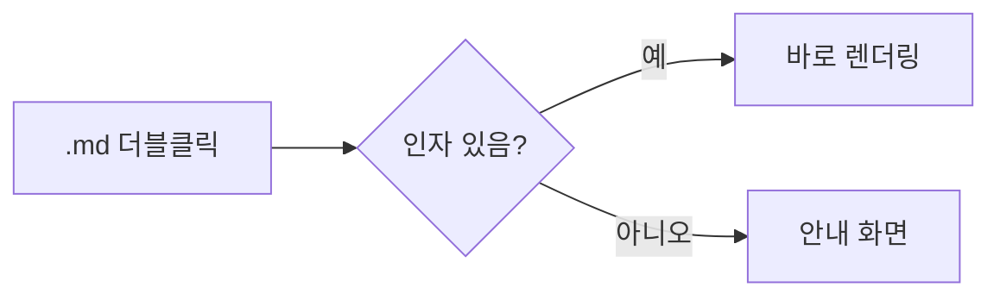

# Graphite 샘플 문서

이 파일로 렌더링 기능을 한 번에 확인할 수 있어요. `⌘E`로 원문을 고쳐 보세요.

## 텍스트

**굵게**, *기울임*, ~~취소선~~, `인라인 코드`, 자동 링크 https://tauri.app 그리고 각주[^1].

> [!NOTE]
> GitHub 알림 블록도 그려져요.

> [!WARNING]
> 배포 전에 저장했는지 꼭 확인하세요.

> 일반 인용문입니다.

1. 파일을 끌어다 놓아요.
2. `⌘E`로 원문을 고쳐요.
3. `⌘S`로 저장해요.

---

## 체크리스트와 표

- [x] 뷰어 모드
- [x] 편집 모드
- [ ] 다음 할 일

| 기능 | 단축키 | 비고 |
|:---|:---:|---:|
| 편집 토글 | ⌘E | 원문 편집 |
| 저장 | ⌘S | 덮어쓰기 |
| 찾기 | ⌘F | Enter / Shift+Enter |

## 코드

```rust
fn main() {
    let name = "Graphite";
    println!("Hello, {name}!"); // 주석
}
```

```js
const sum = (a, b) => a + b;
console.log(sum(1, 2));
```

## 수식

인라인 수식 $e^{i\pi} + 1 = 0$ 과 블록 수식:

$$
\int_{-\infty}^{\infty} e^{-x^2}\,dx = \sqrt{\pi}
$$

## 다이어그램



### 로컬 이미지


<details>
<summary>HTML 접기 블록</summary>

안에 든 내용이에요.

</details>

[^1]: 각주는 문서 맨 아래에 모여요.
